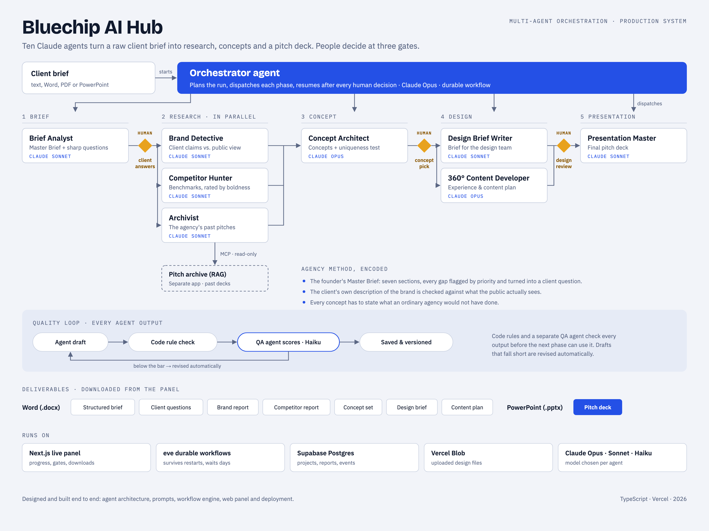

# Bluechip AI Hub

**A production multi-agent AI system that turns a raw client brief into research, concepts and a pitch deck for Bluechip, an events and communications agency.**

Ten Claude agents work through five phases. People make the key decisions at three human gates, and every output is quality-checked before the next agent can use it.

<picture>
  <source media="(prefers-color-scheme: dark)" srcset="docs/bluechip-hub-mimari-dark.png">
  
</picture>

> The source code is private (client work). This repository documents the architecture and the engineering decisions. Code walkthroughs are available on request.

## The problem

At an events agency, each new brief goes through the same slow chain. The team works out what the client really wants, researches the brand and its competitors, digs through old pitches, and then writes concepts and a presentation. The quality depends on who happens to be available that week.

## What the system does

| Phase | Agents | Output |
|---|---|---|
| 1. Brief | Brief Analyst | Structured brief built on the agency's Master Brief template, plus a prioritised list of client questions |
| 2. Research (parallel) | Brand Detective · Competitor Hunter · Archivist | Brand report (client's claims vs. public perception), competitor benchmarks rated by boldness, relevant past pitches |
| 3. Concept | Concept Architect | Concept set; each concept states what an ordinary agency would not have done |
| 4. Design | Design Brief Writer · 360° Content Developer | Brief for the design team, experience and content plan |
| 5. Presentation | Presentation Master | Final pitch deck (PowerPoint) |

An **orchestrator agent** plans the run, dispatches each phase and resumes after every human decision.

## Key engineering decisions

- **Human-in-the-loop gates on durable workflows.** The pipeline pauses at three gates: client answers plus the team's own insight, concept choice, and design review. Runs are durable workflows, so a gate can wait for days and survive restarts and redeploys without losing state.
- **Quality loop on every output.** Each agent returns JSON validated against a Zod schema. Deterministic code rules check it (for example: no duplicate questions, no more than six critical questions, business goal ≠ communication goal). A separate QA agent then scores it against per-agent criteria, and drafts that fall short are revised automatically.
- **Model per job.** Claude Opus for orchestration and creative work, Sonnet for research and analysis, Haiku for QA. Cost follows the difficulty of each task.
- **The agency's own method, encoded.** The founder's Master Brief and brief manifesto are built into the agents' instructions and schemas, so the system asks the questions a senior strategist would ask.
- **Institutional memory over MCP.** The Archivist queries a separate RAG application over the agency's past pitch decks through a read-only MCP connection.
- **Deliverables people already use.** Reports export as Word documents and the final deck as PowerPoint, straight from the panel.
- **Production hardening.** A database quota problem in production was traced to the live panel's polling. Loading report contents only on demand cut the data pulled per refresh by about 78%. A daily keep-alive job and a plan change keep the database from pausing.

## Stack

TypeScript · Next.js · [eve](https://eve.dev) (Vercel's agent framework, durable workflows) · Claude Opus / Sonnet / Haiku via AI Gateway · MCP · Zod · Supabase Postgres · Vercel Blob · docx / PPTX generation · Vercel

## My role

I designed and built the system end to end: agent architecture and prompts, schemas and quality rules, the workflow engine, the web panel, and deployment and operations.
